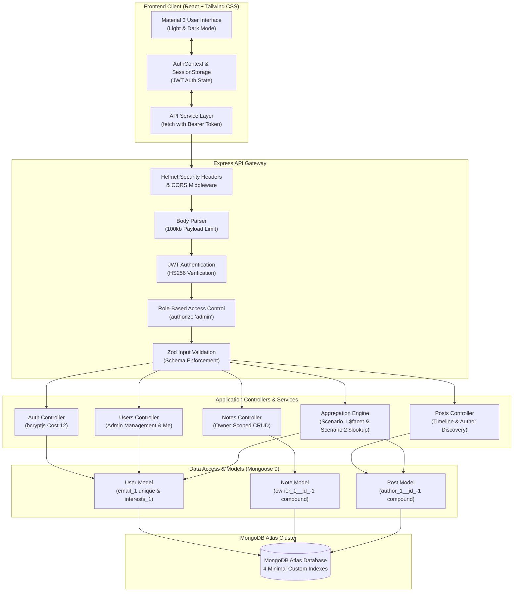

# Secure Note-Taking Application

A production-grade, full-stack secure note-taking platform featuring an Express/Node.js REST backend, MongoDB Atlas database with minimal indexing and aggregation pipelines, and a React + Tailwind CSS frontend designed according to Material Design 3 specifications with reactive Light and Dark theme palettes.

---

## 🏛️ System Architecture



---

## 📁 Project Folder Structure

```
Secure-Note-Taking-Application/
├── client/                               # React Single Page Application (Material Design 3)
│   ├── src/
│   │   ├── assets/                       # Static brand marks & icons
│   │   ├── components/
│   │   │   ├── Header.jsx                # Fixed navigation bar, tabs & user profile dropdown
│   │   │   └── Snackbar.jsx              # Global Material feedback toast notifications
│   │   ├── context/
│   │   │   └── AuthContext.jsx           # JWT session state, user context & theme management
│   │   ├── pages/
│   │   │   ├── AuthPage.jsx              # SignIn / SignUp portal with demo credentials auto-fill
│   │   │   ├── NotesPage.jsx             # My Notes vault, responsive search, modal editor & inspect
│   │   │   ├── PostsPage.jsx             # Public timeline feed, author discovery & Scenario 2 lookup
│   │   │   ├── ProfilePage.jsx           # Account details, interests editor & live RBAC test button
│   │   │   ├── AdminUsersPage.jsx        # Admin user directory, role manager & cascade deletion
│   │   │   ├── AdminAllNotesPage.jsx     # Read-only vault audit with Owner ObjectId filtering
│   │   │   └── AdminInterestsPage.jsx    # Scenario 1 directory cards grouped by distinct interest
│   │   ├── services/
│   │   │   └── api.js                    # Fetch wrapper with Authorization headers & 401 interceptor
│   │   ├── App.jsx                       # Root view orchestrator, tab routing & system footer
│   │   ├── index.css                     # Tailwind v4 import & Light/Dark Material 3 color tokens
│   │   └── main.jsx                      # React 19 entrypoint mounting into root DOM
│   ├── index.html                        # HTML template with Roboto Flex & Material Symbols Outlined
│   ├── package.json                      # Frontend dependencies (tailwindcss, lucide-react, vite)
│   └── vite.config.js                    # Vite configuration with Tailwind CSS plugin & /api proxy
│
├── src/                                  # Express REST API Backend
│   ├── config/
│   │   └── env.js                        # Fail-fast environment variable validation
│   ├── controllers/
│   │   ├── auth.controller.js            # Registration with bcrypt hashing & Login token generation
│   │   ├── notes.controller.js           # Owner-scoped Notes CRUD & Admin inspection
│   │   ├── posts.controller.js           # Post publishing & community author discovery
│   │   └── users.controller.js           # User management, Scenario 1 ($facet) & Scenario 2 ($lookup)
│   ├── middleware/
│   │   ├── auth.js                       # authenticate (HS256) & authorize('admin') RBAC guard
│   │   ├── error.js                      # notFound 404 handler & central error handler
│   │   └── validate.js                   # Zod schema validation middleware
│   ├── models/
│   │   ├── Note.js                       # Note schema with Index #3 (owner_1__id_-1)
│   │   ├── Post.js                       # Post schema with Index #4 (author_1__id_-1)
│   │   └── User.js                       # User schema with Index #1 (email_1) & Index #2 (interests_1)
│   ├── routes/
│   │   ├── auth.routes.js                # Public /api/auth routes
│   │   ├── notes.routes.js               # Authenticated /api/notes routes
│   │   ├── posts.routes.js               # Authenticated /api/posts routes
│   │   └── users.routes.js               # Protected /api/users & aggregation routes
│   ├── utils/
│   │   ├── asyncHandler.js               # Async controller wrapper for Express error propagation
│   │   ├── jwt.js                        # HS256 pinned signToken and verifyToken utilities
│   │   └── pagination.js                 # Standardized pagination parameters and response formatter
│   ├── app.js                            # Express app configuration, Helmet, CORS, static SPA serving
│   └── server.js                         # Database connection with URI sanitization & HTTP server bootstrap
│
├── scripts/                              # Verification, Seeding & Audit Scripts
│   ├── checkIndexes.js                   # MongoDB Index Audit (.explain executionStats verifying IXSCAN)
│   ├── testApi.js                        # Automated 25-step end-to-end API integration test suite
│   ├── seedAdmin.js                      # Initial administrator account seeder
│   └── seedData.js                       # Seed script with test users, sample notes, and timeline posts
│
├── .env.example                          # Committed environment variables template with placeholders
├── .gitignore                            # Strict repository ignore rules (.env, design.md, dist, node_modules)
├── package.json                          # Root configuration, dependencies, and npm test scripts
└── README.md                             # Comprehensive technical documentation & API specifications
```

---

## 🔒 Security Architecture

| Security Domain | Implementation Details |
| :--- | :--- |
| **Authentication** | JSON Web Tokens (JWT) signed with pinned `HS256` algorithm; stored in client-side `sessionStorage` (cleared on tab close); verified on every authenticated request. |
| **Password Security** | Passwords hashed using `bcryptjs` with cost factor 12 (work factor); `passwordHash` field has `select: false` in Mongoose schema to prevent accidental leaks in queries. |
| **Authorization (RBAC)** | Strict role distinction (`user` vs `admin`). Protected administrative endpoints (`/api/users`, `/api/users/by-interests`) enforce `authorize('admin')` middleware, rejecting unauthorized requests with HTTP 403 Forbidden. |
| **Owner Scoping** | Regular users can only read, update, or delete notes they own. Admins can view all notes for auditing, but cannot edit or delete notes belonging to other users. |
| **HTTP Security Headers** | Hardened with `helmet` middleware setting strict Content Security Policy, X-Frame-Options, DNS prefetch control, and HSTS headers. |
| **Payload Limiting** | Express JSON body parser strictly capped at `100kb` to protect against denial-of-service memory exhaustion attacks. |
| **Input Validation** | All request payloads validated using `zod` schemas before reaching controller logic, stripping unpermitted fields and returning structured 400 Bad Request responses. |
| **Secret Isolation** | Secrets (`MONGODB_URI`, `JWT_SECRET`, admin credentials) isolated in untracked `.env` files. Fail-fast validation crashes the server on bootstrap if secrets are missing or `JWT_SECRET` is shorter than 32 characters. |

---

## ⚡ MongoDB Minimal Indexing Strategy

To maintain maximum write throughput and minimize index memory footprint, the application implements **exactly 4 custom indexes** defined explicitly using `schema.index(...)`:

| # | Collection | Custom Index Definition | Type | Target Application Query | Rationale |
| :--- | :--- | :--- | :--- | :--- | :--- |
| **1** | `User` | `{ email: 1 }` (unique: true) | Unique B-Tree | `User.findOne({ email })` | Enforces email uniqueness and provides $O(1)$ fast lookup during registration and login. |
| **2** | `User` | `{ interests: 1 }` | Multikey | `User.aggregate([{ $match: { interests } }, ...])` | Optimizes Scenario 1 directory queries filtering community members by interest tag. |
| **3** | `Note` | `{ owner: 1, _id: -1 }` | Compound | `Note.find({ owner }).sort({ _id: -1 })` | Satisfies Equality-Sort-Range (ESR) rule for owner-scoped note listing and cursor pagination with zero in-memory sort. |
| **4** | `Post` | `{ author: 1, _id: -1 }` | Compound | `Post.find({ author }).sort({ _id: -1 })` | Supports Scenario 2 user posts timeline aggregation and pagination with zero in-memory sort. |

> **Note on Scenario 1 Aggregation**: When querying `GET /api/users/by-interests` without a specific `?interest=` filter, MongoDB processes all registered users across the entire collection to assemble complete community counts. This performs an intentional collection scan (`COLLSCAN`) by design to compute distinct global totals. Providing `?interest=<tag>` immediately uses index #2 (`interests_1`) via the initial `$match` stage.

Run the automated index audit script to verify execution plans against the database:
```bash
npm run check:indexes
```

---

## 📊 Aggregation Pipelines

### Scenario 1: Users by Interests (`GET /api/users/by-interests`)
Groups all users by distinct interests using a single `User.aggregate()` pipeline:
- **Filtering**: Optional `$match` stage using index #2 (`interests_1`).
- **Unwinding**: `$unwind: '$interests'` normalizes interest arrays into individual stream items.
- **Grouping**: `$group: { _id: '$interests', count: { $sum: 1 }, users: { $push: ... } }`.
- **Pagination**: Single `$facet` stage computes both total interest categories count and paginated items in one roundtrip.

### Scenario 2: Posts by User (`GET /api/users/:id/posts`)
Performs a single-pipeline lookup from the `users` collection to `posts`:
- **Identity Check**: Matches user by `_id`, email, or name.
- **Lookup Pipeline**: Joins `posts` matching `author: $$userId`, sorted by `_id: -1` (using compound index #4 `author_1__id_-1`), with `skip` and `limit: limit + 1`.
- **Cursor Pagination**: Inspects `posts.length > limit` to determine `hasMore: true/false` without running an expensive `$count` aggregation over the posts collection.

---

## 🎨 Material Design 3 Frontend (Stitch Specification)

The React frontend (built with Vite and Tailwind CSS) faithfully implements the Google Stitch UI specifications from project `2123888917444584757`:

- **Dual Theme Support**: Full Light (`#faf9fd` surface) and Dark (`#121212` surface) mode toggle with persistent local state.
- **Top Bar Profile Menu**: Clean navigation bar with Profile shifted to an interactive top-right avatar dropdown, featuring account details, edit profile shortcuts, theme switcher, and sign out.
- **Authentication**: Modern tabbed SignIn / SignUp portal with quick-fill demo buttons for Admin and sample Users.
- **Vault Workspace**: 3-column responsive card layout, responsive live search bar, interactive note creator with live character counters, note inspection modal, and delete confirmation dialogs.
- **Feed & Timeline**: Encrypted post composer and community author discovery with 1-click author chips and `limit+1` cursor pagination.
- **Profile & RBAC Verification**: Account details editor with interactive **"Try Admin Action"** button proving the HTTP 403 authorization boundary in real time.
- **Admin Users Console**: Administrative directory with full user management, role modification, cascade deletion safety, and quick timeline inspection.
- **Admin All Notes**: System-wide read-only note vault inspection with Owner ObjectId filter.
- **Admin Interests Directory**: Categorized community member directories powered by aggregation facets.

---

## 🚀 Getting Started

### Prerequisites
- Node.js (v18.x or v20.x+)
- MongoDB Atlas cluster or local MongoDB instance (v6.0+)
- npm (v9.x+)

### 1. Installation
Clone the repository and install root and client dependencies:
```bash
git clone https://github.com/ZamanAsad007/Secure-Note-Taking-Application.git
cd Secure-Note-Taking-Application

# Install backend dependencies
npm install

# Install frontend dependencies
cd client && npm install && cd ..
```

### 2. Environment Configuration
Copy `.env.example` to `.env` and fill in your connection URI and secrets:
```bash
cp .env.example .env
```
Ensure your `.env` contains:
```env
PORT=3000
NODE_ENV=development
MONGODB_URI=mongodb+srv://<user>:<password>@cluster.mongodb.net/secure_notes?retryWrites=true&w=majority
JWT_SECRET=replace_with_a_secure_random_key_at_least_32_characters_long
JWT_EXPIRES_IN=7d
ADMIN_NAME=Admin User
ADMIN_EMAIL=admin@example.com
ADMIN_PASSWORD=AdminSecurePassword123!
BCRYPT_ROUNDS=12
```

### 3. Database Seeding
Seed the initial admin account and sample test users:
```bash
# Seed initial administrator
npm run seed:admin

# Seed sample users, notes, and posts
npm run seed:data
```

### 4. Automated Testing & Verification
Run the unified test command, which automatically executes both the MongoDB execution plan index audit and the 25-step end-to-end API integration suite:
```bash
npm test
```

### 5. Running the Application

**Development Mode:**
```bash
# Run backend API server (runs on http://localhost:3000)
npm run dev

# In a separate terminal, run frontend Vite server (runs on http://localhost:5173)
npm run client
```

**Production Mode:**
```bash
# Build frontend static bundle
npm run build

# Start backend server (serves frontend bundle at http://localhost:3000)
npm start
```

---

## 📡 REST API Reference

### Authentication
| Method | Endpoint | Clearance | Description |
| :--- | :--- | :--- | :--- |
| `POST` | `/api/auth/register` | Public | Register new user account (`name`, `email`, `password`, `interests`). |
| `POST` | `/api/auth/login` | Public | Authenticate with credentials and receive signed JWT. |

### Notes (Vault)
| Method | Endpoint | Clearance | Description |
| :--- | :--- | :--- | :--- |
| `GET` | `/api/notes` | User / Admin | List notes with pagination. Regular users see only their notes; Admins see all notes or filter by `?owner=<id>` or `?owner=me`. |
| `POST` | `/api/notes` | User / Admin | Create a new note owned by authenticated user (`title`, `content`). |
| `GET` | `/api/notes/:id` | User / Admin | Retrieve a specific note by ID (owner-scoped or admin read). |
| `PATCH` | `/api/notes/:id` | Owner Only | Update note title and/or content (only the note owner can modify). |
| `DELETE` | `/api/notes/:id` | Owner Only | Permanently delete note (only the note owner can delete). |

### Users & Directory
| Method | Endpoint | Clearance | Description |
| :--- | :--- | :--- | :--- |
| `GET` | `/api/users/me` | Authenticated | Retrieve profile information for the authenticated user. |
| `PATCH` | `/api/users/me` | Authenticated | Update authenticated user's name and/or interests array. |
| `GET` | `/api/users` | Admin Only | List all registered users with pagination and optional `?role=` filter. |
| `POST` | `/api/users` | Admin Only | Create a new user with assigned role (`user` or `admin`). |
| `GET` | `/api/users/:id` | Self or Admin | Profile by ID. |
| `PATCH` | `/api/users/:id` | Admin Only | Update a user's name, role, or interests. |
| `DELETE` | `/api/users/:id` | Admin Only | Delete user account and cascade delete their notes and posts (prevents self-deletion). |
| `GET` | `/api/users/by-interests` | Admin Only | Scenario 1: Group users by interests with single aggregation pipeline (`?interest=`, `?page=`, `?limit=`). |

### Posts (Timeline)
| Method | Endpoint | Clearance | Description |
| :--- | :--- | :--- | :--- |
| `POST` | `/api/posts` | Authenticated | Publish a public timeline post (`title`, `content`). |
| `GET` | `/api/posts/authors` | Authenticated | Discover active community authors with names, emails, and post counts. |
| `GET` | `/api/users/:id/posts` | Authenticated | Scenario 2: Aggregated posts lookup by user with `hasMore` cursor pagination (`?page=`, `?limit=`). Accepts ObjectId, email, or author name. |

---

## 📜 License
ISC
